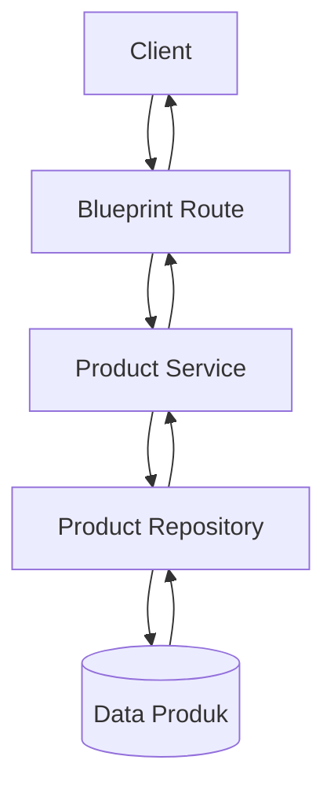

# Backend Project - Refactoring API Produk

## Deskripsi

Project ini merupakan tugas praktikum mata kuliah Dasar Pemrograman Backend menggunakan Python dan Flask. Project ini mengembangkan API Produk dengan struktur Route, Service, dan Repository yang terpisah.

Aplikasi menggunakan Flask Blueprint dan Application Factory untuk membuat struktur backend lebih terorganisasi, serta menerapkan validasi sebagai aturan bisnis.

## Informasi Project

- **Nama Project:** Backend Project Pertemuan 4
- **Mata Kuliah:** Dasar Pemrograman Backend
- **Institusi:** STIKOM PGRI Banyuwangi
- **Resource:** Produk/Barang
- **Framework:** Flask
- **Bahasa Pemrograman:** Python

## Teknologi yang Digunakan

- Python
- Flask
- Python Virtual Environment (venv)
- Git dan GitHub

## Struktur Folder

```text
backend-pertemuan4/
│
├── app/
│   ├── __init__.py
│   ├── config.py
│   │
│   ├── routes/
│   │   ├── __init__.py
│   │   └── product_routes.py
│   │
│   ├── services/
│   │   ├── __init__.py
│   │   └── product_service.py
│   │
│   └── repositories/
│       ├── __init__.py
│       └── product_repo.py
│
├── venv/
├── run.py
├── requirements.txt
├── .gitignore
└── README.md
```

Folder `venv/` digunakan untuk lingkungan Python dan tidak perlu diunggah ke repository GitHub.

## Arsitektur Aplikasi

Alur kerja aplikasi dimulai ketika client mengirimkan request ke Blueprint Route. Route meneruskan proses ke Service untuk menjalankan validasi aturan bisnis. Jika data valid, Service meneruskan penyimpanan ke Repository. Hasil proses kemudian dikembalikan kepada client dalam bentuk JSON.



### Pembagian Tanggung Jawab

1. **Route:** menerima request, memanggil Service, dan mengirimkan response.
2. **Service:** memvalidasi data dan menjalankan aturan bisnis.
3. **Repository:** mengambil dan menyimpan data produk.
4. **Blueprint:** mengelompokkan endpoint produk.
5. **Application Factory:** membuat aplikasi Flask dan mendaftarkan Blueprint.

## Aturan Bisnis

Aturan bisnis yang diterapkan pada API Produk adalah:

1. Nama produk wajib diisi dan tidak boleh kosong.
2. Harga harus berupa angka.
3. Harga harus lebih besar dari nol.
4. Data produk hanya ditambahkan jika lolos validasi.

**Catatan:** Data produk disimpan menggunakan list Python sehingga belum tersimpan secara permanen ke database.

## Persiapan dan Instalasi

### 1. Clone Repository

```bash
git clone URL_REPOSITORY_KAMU
cd backend-pertemuan4
```

Ganti `URL_REPOSITORY_KAMU` dengan URL repository GitHub milik sendiri.

### 2. Membuat Virtual Environment

Jika belum tersedia:

```bash
python -m venv venv
```

### 3. Mengaktifkan Virtual Environment

Untuk Windows PowerShell:

```powershell
.\venv\Scripts\Activate.ps1
```

### 4. Menginstal Dependencies

```bash
pip install -r requirements.txt
```

## Cara Menjalankan Aplikasi

Jalankan perintah berikut dari folder utama project:

```bash
python run.py
```

Jika berhasil, server dapat diakses melalui:

```text
http://127.0.0.1:5000
```

## Dokumentasi Endpoint API

### 1. Root

- **Method:** GET
- **Endpoint:** `/`
- **Fungsi:** Menampilkan pesan bahwa API Produk berjalan.

### 2. Daftar Produk

- **Method:** GET
- **Endpoint:** `/api/v1/products`
- **Fungsi:** Menampilkan seluruh produk yang tersedia.

Contoh response:

```json
{
  "status": "success",
  "total": 2,
  "data": [
    {
      "id": 1,
      "name": "Laptop",
      "price": 12500000
    },
    {
      "id": 2,
      "name": "Mouse Wireless",
      "price": 250000
    }
  ]
}
```

### 3. Menambahkan Produk

- **Method:** POST
- **Endpoint:** `/api/v1/products`
- **Content-Type:** `application/json`
- **Fungsi:** Menambahkan produk baru setelah validasi berhasil.

Contoh request:

```json
{
  "name": "Keyboard",
  "price": 350000
}
```

Contoh response berhasil:

```json
{
  "status": "success",
  "message": "Produk berhasil ditambahkan",
  "data": {
    "id": 3,
    "name": "Keyboard",
    "price": 350000
  }
}
```

## Pengujian API

Pengujian dilakukan menggunakan browser dan PowerShell untuk memastikan endpoint serta aturan bisnis pada API Produk berjalan dengan baik.

| Pengujian | Hasil Pengujian | Status |
|---|---|---|
| GET `/api/v1/products` | Berhasil menampilkan 2 produk awal | Berhasil |
| POST `/api/v1/products` dengan data valid | Produk Keyboard berhasil ditambahkan dengan ID 3 | Berhasil |
| POST dengan harga 0 | Data ditolak dengan pesan "Harga harus lebih dari 0" | Berhasil |
| POST dengan nama kosong atau berisi spasi | Data ditolak dengan pesan "Nama produk wajib diisi" | Berhasil |

Catatan: Data produk disimpan sementara dalam list Python sehingga produk yang ditambahkan akan hilang ketika server dimulai ulang. Pengujian endpoint root (`/`), harga berupa teks, dan harga negatif perlu dicatat setelah hasilnya diperiksa.

## File Pendukung

### .gitignore

File ini digunakan untuk mengabaikan file yang tidak perlu diunggah ke GitHub.

```gitignore
venv/
__pycache__/
*.pyc
.env
```

### requirements.txt

File ini berisi daftar dependency yang diperlukan untuk menjalankan aplikasi Flask.

## Kesimpulan

Project ini menerapkan refactoring backend API Produk menggunakan Flask Blueprint dan Application Factory. Kode dipisahkan menjadi Route, Service, dan Repository sehingga setiap bagian memiliki tanggung jawab yang jelas. Validasi pada Service membantu menjaga agar data produk yang ditambahkan sesuai dengan aturan bisnis yang telah ditentukan.
### 4. Status Aplikasi

- **Method:** GET
- **Endpoint:** `/api/v1/status`
- **Fungsi:** Menampilkan status aplikasi, waktu pengecekan, dan versi Python.

### 5. Informasi Praktikum

- **Method:** GET
- **Endpoint:** `/api/v1/info`
- **Fungsi:** Menampilkan informasi mata kuliah, kode mata kuliah, institusi, dan pertemuan praktikum.

### Pembaruan Pengujian API

| Pengujian | Hasil Pengujian | Status |
|---|---|---|
| GET `/` | Menampilkan pesan API Produk berjalan | Berhasil |
| GET `/api/v1/status` | Menampilkan status aplikasi | Berhasil |
| GET `/api/v1/info` | Menampilkan informasi praktikum | Berhasil |
| GET `/api/v1/products` | Menampilkan daftar produk | Berhasil |
| POST `/api/v1/products` dengan data valid | Produk berhasil ditambahkan | Berhasil |
| POST dengan harga 0 | Data ditolak karena harga harus lebih dari 0 | Berhasil |